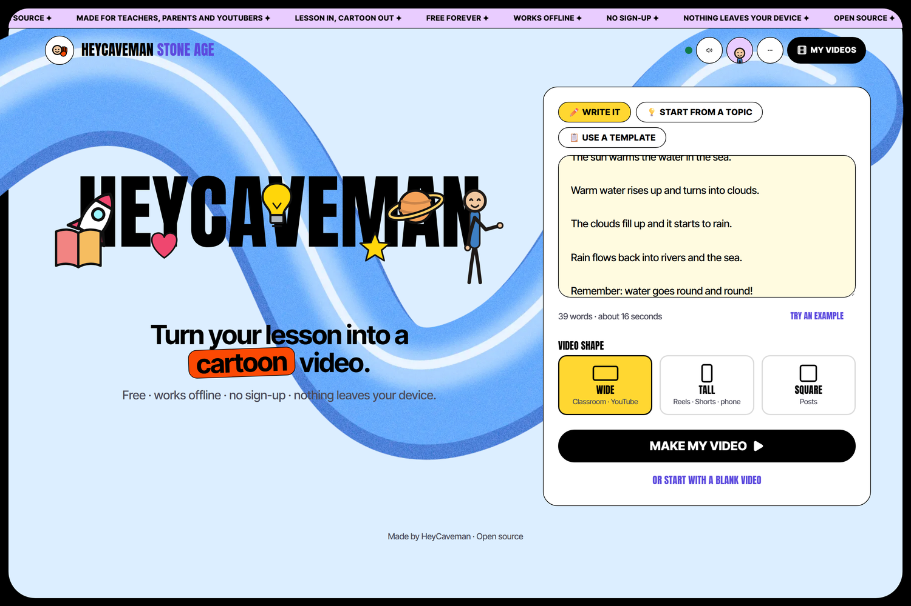
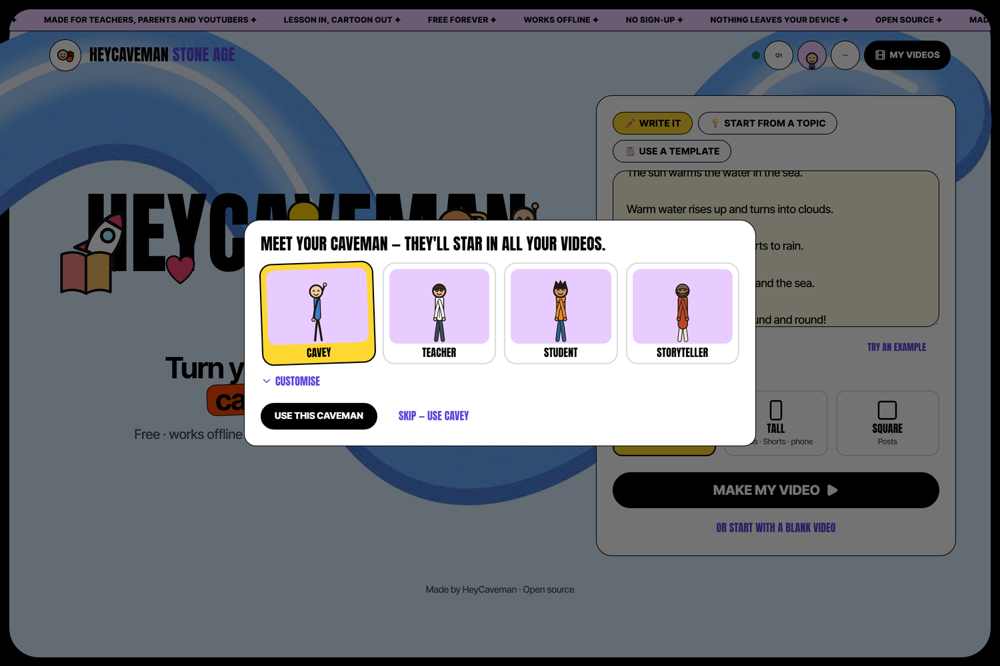
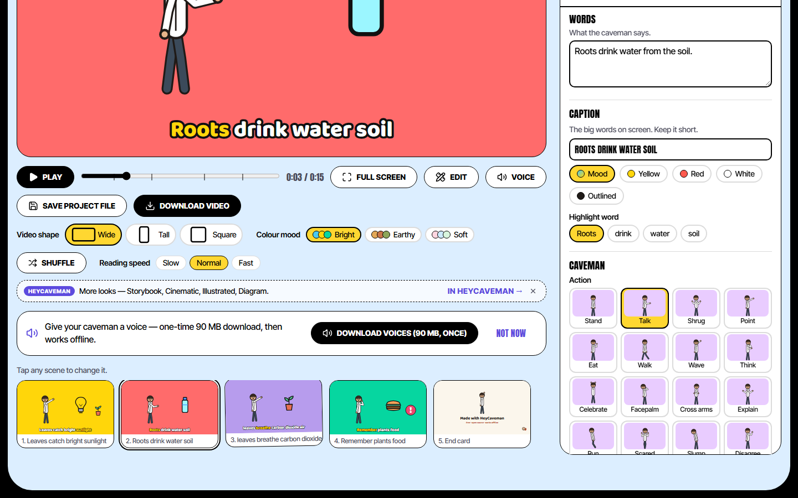
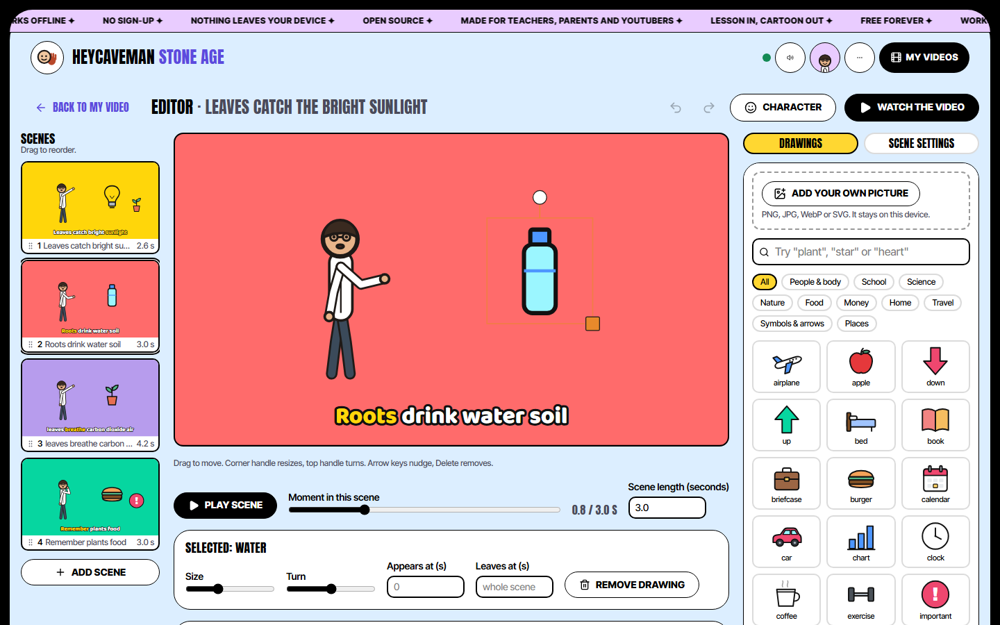
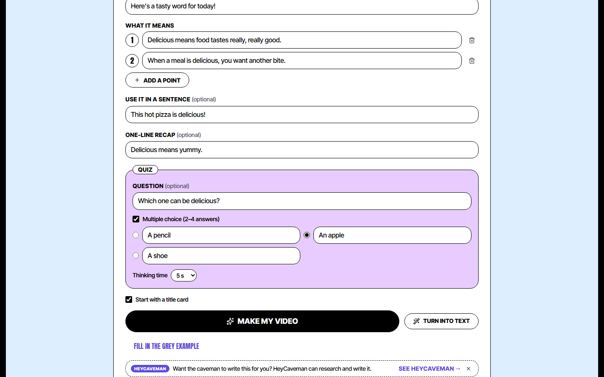
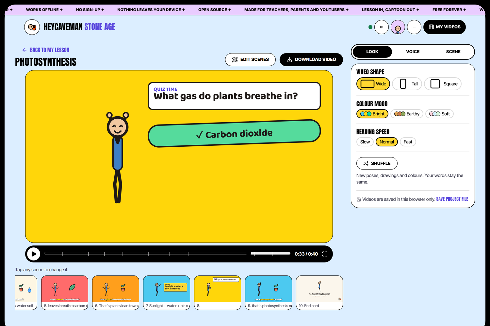
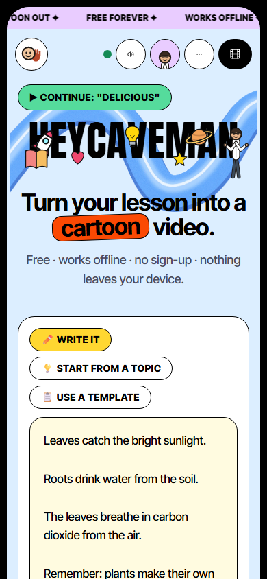
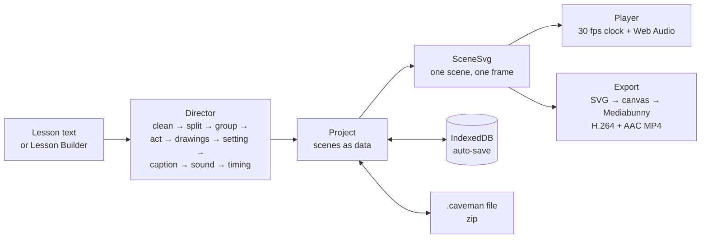

# HeyCaveman: Stone Age

**Type a lesson, get a cartoon explainer video — in your browser, offline, free, with nothing leaving your device.**



Stone Age is the free, open-source edition of HeyCaveman. A teacher pastes a lesson, presses **Make my video**, and the same friendly caveman acts it out scene by scene, with matching drawings, big key-word captions, gentle sound effects and an optional voice. There's no account, no tracking and no AI: an offline "director" turns plain text into scenes with simple, predictable word rules — the same text always makes the same video.

**Who it's for:** teachers, parents and YouTubers who want a short explainer video for a lesson without a video editor, a subscription or uploading anything.

> Built for the Devpost **"Build With AI: Basics"** hackathon with the Devpost Learn skill pack. The planning documents are in this repo: [scope](devpost/scope.md) → [PRD](devpost/prd.md) → [technical spec](devpost/spec.md) → [build checklist](devpost/checklist.md).

---

## Try it in a minute

```bash
git clone <this repository>
cd <the cloned folder>
npm install
npm run build && npm run preview     # open the address it prints
```

Then:

1. Press **Try an example** (or type a few sentences), then **Make my video**.
2. Pick a caveman in **Meet your caveman** (or Skip).
3. Press **Play**. Tap any scene thumbnail to change it. Press **Download video** for an MP4.
4. Try **Use a template → Word of the day → Fill in the grey example → Make my video** for a title card, a recap and a quiz.
5. Turn your Wi-Fi off and do it again: it still works.

For development, `npm run dev` starts a hot-reloading server (slower than the built app).

---

## What it does

| | |
|---|---|
|  | **Your caveman, once.** Four presets or your own design (style, skin, clothes, hair, glasses, beard, head size, name). Every new video uses it; each video keeps its own copy. |
|  | **Make and tweak.** The director picks one of 16 actions and a face per sentence, matching drawings or a place, a key-word caption and a sound. Tap a scene to change its words, caption, action, face, background, drawings or sound. Undo/redo with Ctrl+Z / Ctrl+Y. **Shuffle** re-rolls poses and drawings without touching the words. |
|  | **The Editor.** Drag, resize and rotate drawings and the caveman with snap guides; set when drawings appear; several timed captions per scene; a searchable library; upload your own pictures (resized on the device). Build a video from a blank page. |
|  | **Start from a topic.** A fill-in-the-blanks Lesson Builder (topic, hook, key points, example, recap, quiz) and six templates turn a topic into a script in a proven explainer order: title → hook → points → example → recap → quiz → outro. |
|  | **Lesson scenes.** Title card, recap card, and a quiz with a thinking countdown, then the answer (or "Discuss!") with a ding; multiple choice highlights the right answer. **Pause points** stop the player for class discussion. |

**Also:** natural voices that run on the device after one 90 MB download (Kokoro-82M), or record your own, with lip-sync; Wide, Tall and Square videos; Bright, Earthy and Soft colour moods; reading speed; sound effects On/Gentle/Off; MP4 export in the browser; `.caveman` project files (voices and pictures included); My videos with recently deleted; Paper and Night themes; **Classroom mode** (`?classroom`) that hides every HeyCaveman mention. It installs as an app and works offline.



---

## How it works



- **No AI, by design.** The director (`src/director/`) is pure functions with a seeded random generator: rules for actions and faces, a word-matched drawing library (63 CC0 drawings; words that name a thing beat weak hints like "day" or "bright"), captions that keep the key words, and timing from reading speed or the voice's length.
- **One renderer for everything.** `src/video/SceneSvg.tsx` draws a scene at a frame as SVG. The player redraws it on a clock; the exporter paints the same SVG onto a canvas and encodes it with [Mediabunny](https://mediabunny.dev), so what plays is what exports.
- **The caveman** is a hand-built SVG rig (`src/caveman/`): a skeleton with 16 motions, 6 expressions, Classic and Cartoon styles, blinking and lip-sync from the voice's loudness.
- **Offline first.** A service worker precaches the app (about 5.4 MB on first visit). Projects, recordings and pictures live in IndexedDB; settings too.
- **Voices** run in a Web Worker with [kokoro-js](https://github.com/hexgrad/kokoro) on WebAssembly; the engine files are bundled, the model downloads once from Hugging Face and is cached.
- **Stack:** React 19, TypeScript, Vite, Tailwind CSS 4, zustand, Vitest, Playwright.

## How it was built

The project followed the Devpost Learn skill pack's workflow, with every step written down in [`devpost/`](devpost):

1. **Scope** ([`scope.md`](devpost/scope.md)) — the unique kernel ("the same caveman acts out any lesson, offline") and what's cut.
2. **PRD** ([`prd.md`](devpost/prd.md)) — features F1–F16 with acceptance criteria, edge cases and the look and feel.
3. **Spec** ([`spec.md`](devpost/spec.md)) — architecture, data model, failure modes and decisions.
4. **Build** ([`checklist.md`](devpost/checklist.md)) — nine end-to-end slices, each with a mechanical check and a learner check, committed one at a time. The **Revisions** section records every change of plan and why: replacing Remotion (it sends usage events) with our own renderer, two redesigns from hands-on feedback, and two rounds of performance work measured with frame-rate probes.

The commit history follows the slices in order.

## Quality

- **62 unit tests** (Vitest): the director, scene editing and undo, storage and project files, lessons and templates, colour contrast, shape switching.
- **24 browser tests** (Playwright, real Chromium): make and watch, MP4 export checked with ffprobe/ffmpeg, offline use, voices (real model download and offline voicing), recording with a fake microphone, scene editing, the Editor, caveman/shapes/moods, teacher tools, Classroom mode, and an **axe-core accessibility scan** with no serious issues on the main screens.
- A **network check** in the tests confirms the app makes no requests to other sites while making, editing and exporting.
- `npm run check:public` scans files and git history for secrets and private details before anything is published.

```bash
npm test           # unit tests
npm run test:e2e   # browser tests (first: npx playwright install chromium; needs ffmpeg for the export checks)
```

## Privacy

No account, no analytics, no usage pings, no cookies. Lessons, videos, recordings and pictures stay in the browser on your device. The only network requests the app makes are its own files and, if you choose Caveman voices, the one-time voice-model download from Hugging Face. Links to GitHub and HeyCaveman open only when you click them. For schools: [`docs/for-schools.md`](docs/for-schools.md).

## Project structure

```text
src/
  director/   text → scenes (no AI): clean, split, group, act, props, setting, caption, sfx, timing, lessons, shuffle
  caveman/    the SVG rig, presets and the Meet-your-caveman designer
  video/      SceneSvg renderer, timeline, colour moods, contrast
  export/     MP4 export (Mediabunny), audio mix, embedded assets
  voice/      Kokoro worker, recording, lip-sync envelope
  editor/     scene operations, undo-friendly edits, the Editor stage and library, picture uploads
  screens/    Start, Making, Player, Lesson Builder, scene panel, voice, export, My videos, Settings/Help/About
  storage/    IndexedDB, .caveman files, two-tab safety
  offline/    service worker and offline status
devpost/      scope, PRD, spec and build checklist
docs/         for-schools sheet, screenshots
tests/        unit (Vitest) and e2e (Playwright)
scripts/      privacy scan, asset manifest, icons, ribbon image, screenshots
```

## Pre-existing work and AI assistance

- **New code:** all application code in this repository was written during the hackathon, with an AI coding agent (Claude Code), following the Devpost Learn skill pack (`.agents/skills/`).
- **Copied assets (pre-existing work):** the drawings, sound effects and music are copied from the author's earlier HeyCaveman project, where code written with AI assistance generated them on 5–13 October 2026. They're released here under CC0. No code from that project is reused. Details: [`assets/LICENSE-ASSETS.md`](assets/LICENSE-ASSETS.md).
- **New drawings:** sun, leaf, cloud, rain, tree and water drop were drawn new for this repository on 22 October 2026, with AI assistance, and are CC0 too.

## Licence

- **Code:** [AGPL-3.0](LICENSE).
- **Art and sounds:** CC0 — see [`assets/LICENSE-ASSETS.md`](assets/LICENSE-ASSETS.md).
- **Libraries:** Mediabunny (MPL-2.0) encodes the video; kokoro-js (Apache-2.0) runs the voices; fonts Anton, Inter Tight and Baloo 2 (SIL Open Font License); icons Lucide (ISC).
